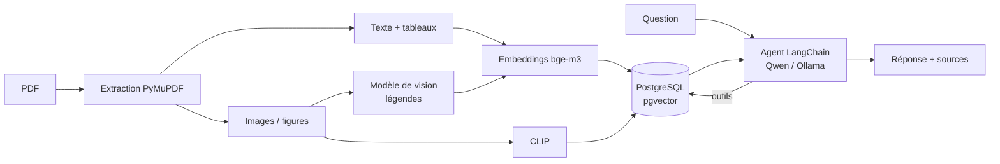

# 🔧 MaintiDoc

Assistant documentaire destiné aux techniciens de maintenance. Il exploite des manuels techniques (texte, tableaux, schémas, photos) pour répondre à des questions avec des **références vérifiables** (fichier + page).

> **État du projet : Étape 1 sur 4** — RAG agentique multimodal.
> MaintiDoc ne pilote aucun équipement et ne remplace pas un technicien habilité.

## Fonctionnalités

- **Extraction multimodale** d'un PDF : texte, tableaux, images et figures vectorielles (PyMuPDF)
- **Indexation vectorielle** avec LlamaIndex, embeddings open source (`BAAI/bge-m3`) et stockage dans **PostgreSQL + pgvector**
- **Recherche d'images** avec **CLIP** et par **légendes textuelles** générées par un modèle de vision
- **Pipeline RAG** avec un LLM open source (Qwen via **Ollama**), réponses fondées sur le contexte retrouvé et citées `[fichier p.N]`
- **Agent LangChain** qui choisit ses outils de recherche (texte, tableaux, figures, recherche visuelle)
- **Interface Streamlit** : chargement du PDF, chat, photo optionnelle, affichage des sources consultées

## Architecture



## Prérequis

- Python 3.10+ (testé avec 3.12)
- [Docker](https://www.docker.com/) (pour PostgreSQL + pgvector)
- [Ollama](https://ollama.com/)
- RAM conseillée : 16 Go pour les modèles 7B ; 8 Go suffisent avec les modèles 3B

## Installation

```bash
git clone https://github.com/<votre-compte>/maintidoc.git
cd maintidoc

# 1. Base de données
docker compose up -d

# 2. Modèles Ollama
ollama pull qwen2.5:7b        # LLM (ou qwen2.5:3b si peu de RAM)
ollama pull qwen2.5vl:3b      # légendes d'images et description de photos

# 3. Dépendances Python
python -m venv .venv
.venv\Scripts\activate        # Linux/macOS : source .venv/bin/activate
pip install -r requirements.txt
```

## Utilisation

```bash
streamlit run app.py
```

1. Chargez un PDF dans la barre latérale, puis cliquez sur **Indexer le document**.
2. Posez vos questions dans le chat.
3. (Optionnel) Joignez une photo d'équipement : elle est décrite automatiquement et la description est ajoutée à la question.
4. Ouvrez **Sources consultées** pour vérifier les passages et figures utilisés.

Exemples de questions :
- « Quelles sont les valeurs de la table de comparaison des modèles ? »
- « Montre le schéma de l'architecture. »
- « Explique le mécanisme décrit à la section 3. »

## Structure du projet

| Fichier | Rôle |
|---|---|
| `app.py` | Interface Streamlit |
| `agent.py` | Agent LangChain et prompt système |
| `tools.py` | Outils de recherche (texte, tableaux, figures, CLIP) |
| `ingest.py` | Extraction du PDF, légendes, indexation |
| `stores.py` | Connexions pgvector, modèles d'embeddings et CLIP |
| `config.py` | Paramètres (modèles, base de données) |
| `docker-compose.yml` | PostgreSQL + pgvector |

## Configuration

Les modèles se règlent dans `config.py` ou par variables d'environnement :

| Variable | Défaut | Description |
|---|---|---|
| `LLM_MODEL` | `qwen2.5:7b` | LLM de génération (doit gérer les appels d'outils) |
| `VLM_MODEL` | `qwen2.5vl:3b` | Modèle de vision |
| `PGHOST`, `PGPORT` | `localhost`, `5432` | Connexion PostgreSQL |

Pour changer le modèle d'embeddings, modifiez aussi `EMBED_DIM` (1024 pour `bge-m3`) et recréez les tables.

## Réinitialiser l'index

```bash
docker compose exec db psql -U maintidoc -d maintidoc -c "DROP TABLE IF EXISTS data_text_chunks, data_clip_images;"
```

## Dépannage

| Erreur | Cause et solution |
|---|---|
| `model '...' not found (404)` | Modèle non téléchargé : `ollama pull <modèle>` |
| `unable to allocate ... buffer (500)` | RAM insuffisante : utiliser un modèle plus petit (3B), fermer d'autres applications |
| Résultats en double | Document indexé plusieurs fois : réinitialiser l'index (voir ci-dessus) |
| Schéma introuvable | Les figures vectorielles sont détectées par heuristique ; vérifier le dossier `data/images` |

## Limites connues

- L'extraction de tableaux fonctionne mieux sur les tableaux à bordures.
- CLIP comprend surtout l'anglais pour les requêtes textuelles.
- La qualité des légendes dépend du modèle de vision choisi.
- Les réponses doivent toujours être vérifiées dans les sources citées.

## Feuille de route

- [x] **Étape 1** — RAG agentique multimodal
- [ ] **Étape 2** — Fine-tuning
- [ ] **Étape 3** — Orchestration agentique et MCP (historique des interventions, préparation de tickets avec validation humaine)
- [ ] **Étape 4** — Client web, Telegram/Discord, sécurité et déploiement

## Licence

À définir (par exemple MIT).
